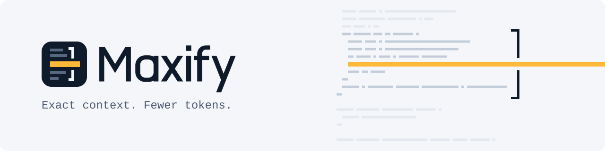

<p align="center">
  <picture>
    <source media="(prefers-color-scheme: dark)" srcset="assets/brand/banner-dark.svg">
    
  </picture>
</p>

# Maxify MCP

Maxify is a local MCP server and CLI that helps Claude Code finish coding tasks with fewer tokens **without losing the evidence it needs to write correct code**.

It indexes a TypeScript / JavaScript / React / Node.js repository and answers a task in one call with a budgeted package: a ranked map, the **exact current source** of the symbols that matter, their contracts and tests, every relation tagged by provenance, the gaps static analysis could not close, and exact refs for anything it left out. It also compresses noisy command output while keeping every error line and a recoverable original.

> **Product rule:** saving tokens only counts if the agent still completes the task correctly. A token reduction with a worse resolution rate is reported as a regression.

**Status:** MVP, version 0.1.0, on npm as [`maxify-mcp`](https://www.npmjs.com/package/maxify-mcp).
Everything runs locally and deterministically: no API keys, no embeddings, no LLM calls, no telemetry.

## What it does

| Tool | What the agent gets |
|---|---|
| `maxify_context` | For a task and a token budget: ranked map, exact source of key symbols (`[src]`), derived signatures (`[sig]`, labelled as not source), callers, callees, contract types, related tests, uncertainties, omitted refs and a cursor. Never cuts code mid-symbol. |
| `maxify_source` | Exact current source by `path`, `path:START-END`, `path#Qual.Name`, `Name` or `blob:HASH`. Verified against disk; long sources paginate explicitly. |
| `maxify_impact` | Direct and transitive dependents, tests likely affected, exported API surface, and unlinkable dynamic imports. |
| `maxify_compress` | Logs, test runs, search results, JSON, listings and diffs compressed with every critical line kept verbatim; exact original retrievable by `blob:HASH`. |
| `maxify_memory` | Small notes (agent or user) anchored to code hashes, shown as `current` or `STALE`, never as verified source. |
| `maxify_stats` | Index health, freshness, local metrics, and known limitations. |

Every relation is tagged:
`extracted` (one file's syntax), `resolved` (static module resolution through aliases and barrel re-exports), or `heuristic` (naming convention). Dynamic `import()` with computed specifiers, computed calls and unresolved specifiers are listed as **uncertain**, never guessed.

## Requirements

- Node.js **22.13 or newer** (uses the built-in `node:sqlite` with FTS5; no native build step). Tested on Node 22.22.1.
- Claude Code (tested with 2.1.87) or any MCP client that speaks stdio.

## Install

```bash
npm install -g maxify-mcp
maxify doctor            # environment, SQLite/FTS5, TypeScript API, MCP self-test
```

## Use it with Claude Code

**Every project, no global install** (user scope; the package runs through `npx`):

```bash
claude mcp add --scope user maxify -- npx -y maxify-mcp serve
# native Windows (not WSL): npx needs a cmd wrapper
claude mcp add --scope user maxify -- cmd /c npx -y maxify-mcp serve
```

**One project, shared with the team** (after `npm install -g maxify-mcp`), in the repository you want to work on:

```bash
maxify init        # writes/merges .mcp.json (project scope) and builds the first index
```

`init` adds this entry to the project's `.mcp.json` (other servers are preserved):

```json
{
  "mcpServers": {
    "maxify": { "type": "stdio", "command": "node", "args": ["/abs/path/to/maxify-mcp/dist/cli.js", "serve"] }
  }
}
```

**Other MCP clients** (any client that speaks stdio):

```json
{
  "mcpServers": {
    "maxify": { "command": "npx", "args": ["-y", "maxify-mcp", "serve", "--root", "/abs/path/to/your/repo"] }
  }
}
```

Without `CLAUDE_PROJECT_DIR` the server uses its working directory as the repository root; pass `--root` when the client starts it somewhere else.

Tool overhead (measured by `maxify stats`/`doctor`, estimated tokens): about 830 tokens upfront (instructions plus the two always-loaded tools, `maxify_context` and `maxify_source`), about 2,000 if every schema is loaded; the other four tools stay deferred until Claude searches for them.

Restart Claude Code in that project and approve the project server when asked (`claude mcp list` shows it). Claude Code passes `CLAUDE_PROJECT_DIR`, which Maxify uses as the repository root. See [examples/](examples/) for a manual configuration and an optional `CLAUDE.md` snippet.

The server sends Claude short instructions (about 150 estimated tokens): call `maxify_context` first, expand with `maxify_source` when evidence is omitted or signature-only, Read the exact line range before editing, check `maxify_impact` before changing exported APIs, and pipe long command output through `maxify compress`.

### Keep raw logs out of the context

An MCP server cannot intercept Claude Code's own Bash output. The cheapest path is to never let the raw output in:

```bash
npm test 2>&1 | maxify compress --kind test
# bash: also keep the real exit code
npm test 2>&1 | maxify compress --kind test; echo "exit=${PIPESTATUS[0]}"
```

The compressed text keeps every failure block, assertion diff and summary line, and ends with a `blob:HASH` ref. `maxify compress --ref HASH --lines 120-180` (or `maxify_compress {ref, lines}`) returns any original range exactly.

## Build from source

```bash
git clone https://github.com/Angelfmoncada/maxify-mcp.git && cd maxify-mcp
npm ci
npm run build
node dist/cli.js doctor
```

Optional: `npm link` puts this build's `maxify` on your PATH (it changes your global npm setup, so it is not done for you).

## CLI

| Command | Purpose |
|---|---|
| `maxify init` | Configure the project for Claude Code and index it. |
| `maxify index [--full]` | Incremental (default) or full re-index. |
| `maxify serve` | stdio MCP server (stdout carries only JSON-RPC). |
| `maxify query "<task>" [--budget N]` | What `maxify_context` would return. |
| `maxify source <ref>` · `maxify impact <targets...>` | Exact source; impact analysis. |
| `maxify compress [file]` | Compress a file or stdin; `--ref HASH [--lines A-B]` to recover. |
| `maxify memory <op>` | Notes: add, search, list, get, update, delete. |
| `maxify stats` | Index health, local metrics, tool-surface token overhead. |
| `maxify bench` | Offline benchmark (see below). |
| `maxify doctor` | Diagnostics with PASS/WARN/FAIL. |

Global options: `--root`, `--state-dir`, `--config`, `--json`, `--quiet`.

## Configuration

Optional `maxify.config.json` at the repository root:

```json
{
  "exclude": ["fixtures/", "*.generated.ts"],
  "respectGitignore": true,
  "maxFileBytes": 1000000,
  "extraSecretPatterns": ["deploy/keys/"],
  "context": { "defaultBudget": 6000, "includeTests": true, "delta": false },
  "compress": { "blobTtlDays": 7, "maxStoreMB": 200, "defaultMaxTokens": 1200 }
}
```

Also honored: every `.gitignore`, `.git/info/exclude`, and `.maxifyignore`. Secret files (`.env*` except examples, keys, certificates, credential files, PEM private keys by content) are never read.

Indexes live outside the repository, one per root (`%LOCALAPPDATA%\maxify\repos\…`, `~/Library/Caches/maxify/…`, `$XDG_CACHE_HOME/maxify/…`); override with `MAXIFY_HOME` or `--state-dir`.

## Benchmarks

Offline suite (18 tasks on a React + Node + TypeScript fixture, local token estimates, **not agent results**):

| Strategy | Tokens per task | Evidence reached |
|---|---|---|
| Maxify, 1 call, default budget 6000 | 5,031 | 70 % |
| Maxify + one follow-up per missing item | 5,445 | 100 % |
| Simulated grep + read 3 files | 5,857 | 30 % |
| Simulated grep + read 8 line windows | 15,134 | 68 % |

At budgets 2000 and 4000 the first call reaches less evidence than the 8-window strategy; the suite flags that as a regression, which is why the default is 6000. The agent benchmark (Claude Code end to end, native versus Maxify) is built and dry-run verified but **not executed yet**, so no session-level or cost savings are claimed. Methodology, caveats and reproduction: [docs/BENCHMARKS.md](docs/BENCHMARKS.md).

## Limitations

- Maxify only controls its own tool results. It cannot shrink native Read/Grep/Bash output, the system prompt, or the model's reasoning.
- No type checker: method calls on typed objects (`obj.method()`), dependency injection and reflection are not linked.
- Structural languages: TS/JS/JSX, Markdown, JSON. Other text files are indexed as line chunks without symbols.
- The cache saves CPU and latency, not tokens. Delta responses are off by default.
- Claude Code's Edit tool still requires a Read of the file; Maxify tells the agent the exact line range to Read.

## Documentation

- [docs/ARCHITECTURE.md](docs/ARCHITECTURE.md) — pipeline, data model, provenance, freshness, security model.
- [docs/RESEARCH.md](docs/RESEARCH.md) — Claude Code MCP facts, hypotheses, technical decisions.
- [docs/BENCHMARKS.md](docs/BENCHMARKS.md) — methodology, results, limitations.
- [assets/brand/BRAND.md](assets/brand/BRAND.md) — logo and colors.

## License

MIT. See [LICENSE](LICENSE).
